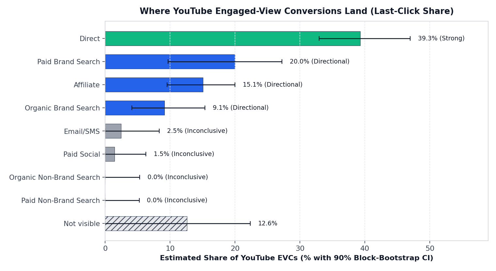
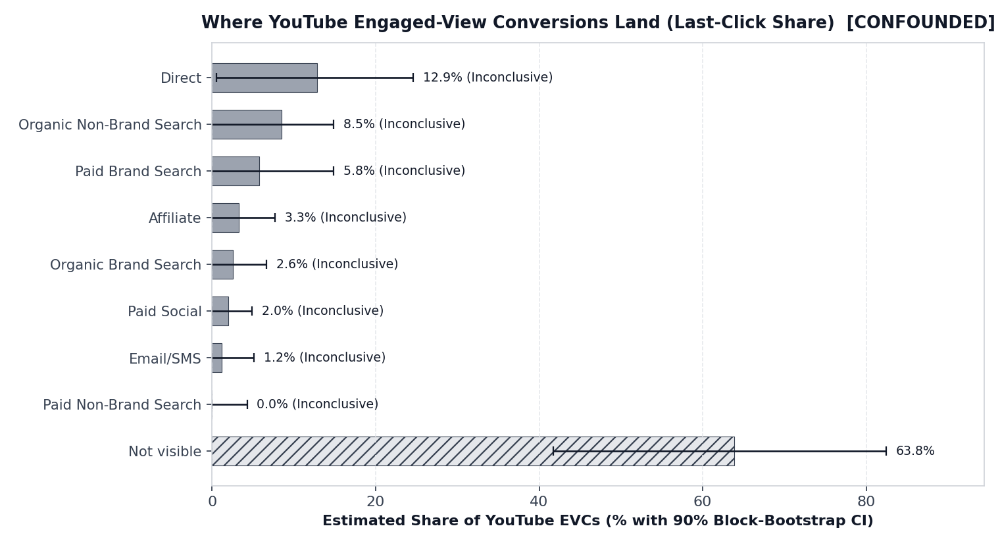

# evc-landing-estimator

[](https://github.com/Benfinkels/evc-landing-estimator/actions/workflows/ci.yml)
[](https://www.python.org/downloads/)
[](LICENSE)
[](https://colab.research.google.com/github/Benfinkels/evc-landing-estimator/blob/main/notebooks/evc_landing_estimator.ipynb)

Estimate which last-click channels (Direct, Brand Search, Affiliate, etc.) are absorbing your Google Ads YouTube **Engaged-View Conversions (EVCs)**, from any CRM, UTM, or GA4 export.

## Why

When a user watches a YouTube ad (≥10s) without clicking and converts within 3 days, Google Ads counts an EVC. Your own analytics or CRM records that same conversion under last-click credit (often Direct, Brand Search, or Affiliate). No standard report shows how EVCs split across those channels. This tool estimates the split from daily totals alone.

## Quickstart

```bash
pip install -e .
evc-landing-estimator demo --scenario known_split --out-dir out/
evc-landing-estimator run --conversions crm_leads.csv --evc google_ads_evc.csv --ads-tz America/New_York --brand-terms "acme" --out-dir out/
```

Preview channel mapping and unmapped raw values before modeling:

```bash
evc-landing-estimator map --conversions crm_leads.csv --brand-terms "acme"
```

## Inputs

| Input | Supported Formats | What's needed |
| :--- | :--- | :--- |
| **Conversions** | CSV or XLSX (row-level CRM/UTM log, GA4 daily export, wide table, or date-header pivot) | Timestamp/date + at least one of `source`, `medium`, or `channel`. Optional `id` (deduplicated), `campaign`/`term` (brand split), `conversions` weight. |
| **Google Ads EVC** | CSV or XLSX (handles title rows, `Total` footer, `"1,234"`, and `"--"`) | `Day` + `Engaged-view conversions` exported for the **same conversion action** as your conversions file. |
| **Controls *(optional)*** | CSV or XLSX (`--controls`) | `date` + numeric flags for promos, holidays, or price changes. |

Channel mapping is driven by an editable, deterministic regex table ([`channel_rules.csv`](src/evc_landing_estimator/channel_rules.csv)) with zero LLM calls.

## How It Works

For each modeled channel $c$ on day $t$:

$$Y_c(t) = D(t)^\top \beta_c + w_c \sum_{L=0}^{L_{\max}} k_L \, E(t - L) + \varepsilon_c(t), \qquad w_c \ge 0,\ \ \sum_c w_c \le 1$$

- **Forward time direction:** `E(t - L)` lags EVCs forward (`impression_time`, default `L = 0..3`); switch `--date-basis conversion_time` to anchor on `L = 0`.
- **Shared delay curve (`k`):** One 0–3 day view-to-conversion curve shared across all channels, keeping estimation stable on short daily series.
- **Adding-up constraint:** Channel shares are projected onto `{w >= 0, sum(w) <= 1}`. The remainder `1 - sum(w)` is reported as **Not visible** (consent loss, cross-device, app, or excluded channels).
- **Uncertainty:** 7-day moving-block bootstrap (default 500 draws) produces 90% confidence intervals and `P(#1)` (probability a channel is the top landing spot).
- **Guardrails:** A **future-EVC lead check** (`E(t+1..t+2)`) flags shared demand shocks as `Confounded`, and a **planted-signal power test** injects a known +25% share into your actual noise to verify recoverability before trusting a channel.

## Reading the Results

- **Strong:** 90% CI lower bound ≥ 10%, passes power test, not confounded.
- **Directional:** 90% CI lower bound between 1% and 10%, passes power test, not confounded.
- **Inconclusive:** 90% CI lower bound ≤ 1%, or channel failed the planted-signal power test.
- **Confounded:** Future EVCs predict current conversions (`lead_flag = True`) on a positive-share channel.
- **`P(#1)`:** Share of bootstrap draws where the channel ranks #1.

Outputs written to `--out-dir`: `results.json`, `results.xlsx` (8 sheets), self-contained `report.html`, and 4 PNG charts.

## Validation (Synthetic Ground Truth)

On the bundled 180-day synthetic CRM dataset (planted truth: **Direct 40%**, **Paid Brand Search 20%**, **Affiliate 15%**, **Organic Brand Search 10%**, **Not visible 15%**, four null channels at **0%**), the model recovers every channel within ±2 percentage points and labels all null channels `Inconclusive`:



On the pure-confounder scenario (**0% true EVC overlap**, six simultaneous promo waves lifting EVCs and Direct/Paid Brand together), the future-EVC lead check catches the shared demand shock and flags `CONFOUNDED`:



## Limitations

- **Not incrementality or ROI:** EVCs are double-counted conversions. This tool estimates where conversions get last-click credit, not whether YouTube caused them. It intentionally does not output revenue or ROAS.
- **Not user-level matching:** All estimates come from daily aggregate totals.
- **Not proof:** Unlogged promos lifting EVCs and a channel simultaneously can mimic overlap. Pass `--controls` when you have them; only a holdout or geo test rules confounding out completely.
- **Low EVC volume:** When daily EVCs are tiny relative to channel noise, the power test flags channels as `Inconclusive` rather than fabricating shares.

## v1 → v2: What Was Wrong

The original prototype is preserved at git tag [`v1-legacy`](../../tree/v1-legacy). Six defects motivated this rewrite:

1. **Backward lag shift:** v1 used `df_X.shift(+lag)` with `y = EVC`, testing whether *past* site visits caused *today's* ad views.
2. **Sessions instead of conversions:** Modeling sessions answers a traffic-halo question, not where EVC conversions receive last-click credit.
3. **Zero-intercept NNLS on raw totals:** Forcing baseline organic traffic through `(0, 0)` credited baseline volume to YouTube (>100% attribution).
4. **Broken pipeline state:** Cell 2 never saved `EVC_Competitive_Model.csv` outside Colab download, causing the ROI cell to fail.
5. **Fragile column matching:** Exact `'EVC'` matching missed `'Engaged-View Conversions'` and defaulted to `'Date'`.
6. **Hardcoded `lag = 1`:** The visualizer and HTML report ignored the selected lag.

## License

MIT — see [`LICENSE`](LICENSE).
